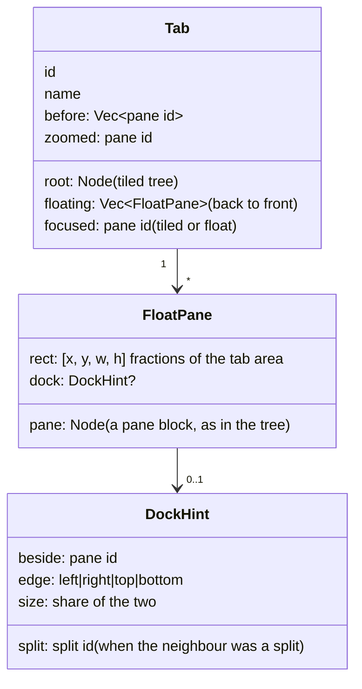
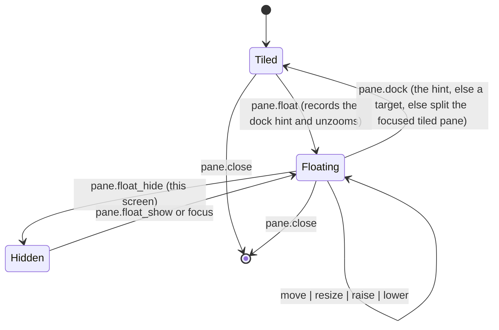
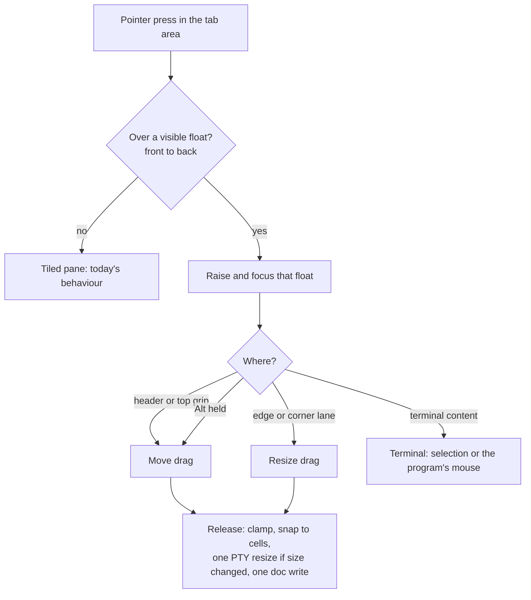

# Floating panes

## TL;DR

- **What:** any pane in a tab can float above that tab's tiled panes, and dock back. Several floats per tab, each with its own stacking order. The focused float is on top. Floats move and resize by keyboard (phase 1) and by mouse (phase 2).
- **Model:** each tab gains a floating layer, `Tab.floating: Vec<FloatPane>`. A `FloatPane` holds the same pane `Node` the tiled tree would hold, plus `rect: [x, y, w, h]` as fractions of the tab area and a `DockHint` (the pane it was split with, its side and share). List order is stacking order (last = front). The pane keeps its id, terminal, name and icon when it floats or docks.
- **Persistence:** the floating layer is structure, so it goes in the machine's core `herdr-app` document, next to `root` in each tab. Focus, zoom and "hidden" stay on this screen (`view.json`). A float's terminal stays on its tab's machine by construction. No version bump: an absent field means no floats.
- **Commands:** `pane.float`, `pane.dock`, `pane.float_toggle`, `pane.float_move`, `pane.float_resize`, `pane.raise`, `pane.lower`. `pane.go`, `pane.zoom`, `pane.close` and focus history learn about floats. `panes()[i].floating` exposes the geometry to mods and `herdr-app ls`.
- **Upstream:** all three ADR-001 (fork architecture stance) questions answer yes, so the verdict is C. Open the upstream issue first: the document field is a compatibility promise. Build phase 1 on a branch cut from `upstream/master` while the issue is open, so it can be offered as it is.
- **Size:** phase 1 is about 1,100 to 1,400 lines of Rust with tests (medium risk). Phase 2 is about 450 to 650 (medium). Phase 3 is about 500 to 800 (low to medium).

## Goals and non-goals

- **Goals:**
  - Float any existing pane, terminal or mod, and dock it back where it was.
  - Move and resize floats by keyboard and mouse.
  - Several floats per tab, with z-order and focus.
  - The floats survive a restart and show on every screen connected to the machine.
- **Non-goals:**
  - Floats that span tabs or spaces. A float belongs to one tab, like a tiled pane. tuios's "pin across workspaces" is declared there but unused.
  - A whole-tab "floating mode", as tuios's tiling toggle offers. Herdr tabs stay tiled. Floating is per pane.
  - A float holding a split tree, as Rex's layers can. One float holds one pane. A later field can lift that limit without a migration (see "Open questions").
  - Replacing `terminal.popup`, `terminal.peek` or mod `window` overlays. Those remain app-level, transient and outside the tab. A floating pane belongs to the tab's structure.

## What exists today

| Mechanism | Where | Free position | In the machine document | Z-order | Gap for "float this pane" |
| --- | --- | --- | --- | --- | --- |
| Layout floating blocks (`Float`) | `src/layout.rs:64`, `src/window/floats.rs` | no: snaps to an edge and a third | no: layout clicks in `layouts/.state/` | none | Layout chrome, sized by content. Terminal content draws fixed at 560×320 (`floats.rs:134`) |
| Mod `window` overlays | `src/window/movable.rs` | yes, pixels, `KEEP_SHOWN` 48 px clamp | no: `windows.json`, this screen only | the last pressed is on top | Belongs to the layout (closed on layout switch). Not in the tab. Invisible to `pane.go` and focus history |
| `terminal.peek` / `terminal.popup` | `src/window.rs:4762`, `:4815` | no: centered dialog | no | one at a time | Modal and transient |
| The user's `scratch` mod | `~/.config/herdr-app/mods/scratch/main.js` | via `window` overlay | no | as above | Its own terminals, not an existing pane |
| The user's `float-space` mod | `~/.config/herdr-app/mods/float-space/` | presets (fractions 0.2 to 0.95) | mod state | one window | Its own terminals |
| The user's `pane-move/relocate.js` | `~/.config/herdr-app/mods/pane-move/relocate.js` | n/a | n/a | n/a | `terminal.park` then `terminal.keep`, polling `panes()` every 100 ms for up to 10 s. A new pane id each time; icon and spot lost |

🔑 A mod can fake "float this pane" as park → `window` overlay → keep. It loses the pane's identity and spot. The float lives only on this screen and dies with a layout switch. That gap is the case for the core change.

## Reference behaviour: tuios and Rex

Sources:
- **tuios:** the local checkout `~/my-workspace/util/tuios`: `internal/app/os_window.go`, `internal/input/mouse_click.go`, `internal/input/border_resize.go`, `internal/app/render.go`, `internal/session/session.go`, `internal/config/userconfig.go`.
- **Rex:** `rex __internal skill`, `rex api list`, https://www.superlogical.com/rex/docs/reference/api.md, https://www.superlogical.com/rex/docs/reference/mac-actions.md, and the user's `~/.config/rex/init.lua:49-102`.

| Aspect | tuios | Rex | Proposed Herdr |
| --- | --- | --- | --- |
| Where floats live | One flat window list per workspace. `IsFloating` per window, plus a session-wide "tiling off" mode | Per window (a tab): one tiled layout plus a stack of floating layers | Per tab: `Tab.floating`, above the tiled tree |
| Float an existing pane | `ToggleFloating`. Palette only in the TUI (text user interface). `ctrl+shift+alt+f` in the GUI (graphical user interface) bridge | `session.float_block {block_id, bounds}`. Mac action `pane.float`, `alt+cmd+enter` | `pane.float {pane?, rect?}`, `pane.float_toggle`. macOS `cmd-alt-enter` (Rex's key) |
| Dock back | Re-inserts it like a new pane: splits the last BSP leaf at the default ratio, or adds a column after the focused one (`ToggleFloating`, about 50 lines). No position restored | `session.move_block(anchor, side, ratio)`, the caller choosing. No dedicated dock | `pane.dock {pane?, target?, edge?}`. Default: beside the pane (or split) it was split with, same side, same share; an arranged tab puts it there in reading order. Else beside the tiled pane focused last |
| Geometry | Integer cells. Rescaled proportionally on reattach | Fractions of the window, `[x, y, w, h]` | Fractions of the tab area. Snapped to whole cells when drawn |
| Remembered float spot | No (`PreZoom*` and `PreMinimize*` only) | Layer bounds are kept while minimized | The float's `rect` is kept while hidden. The last rect is kept on dock, so a re-float returns to it (phase 3) |
| Clamping | At least 20 columns × 3 rows stay inside the content area | The layer must fit inside the window | Fully inside the tab area. Minimum 20 columns × 4 rows, or the area if smaller |
| Several floats | Yes | Yes | Yes |
| Z-order | Focus raises. Floats always above tiles. No explicit raise or lower | `raise_layer` / `lower_layer`, optionally relative to another layer. Never behind the layout | Focus raises. `pane.raise` / `pane.lower`. Never behind tiles |
| Focus | Click only. Tab and Shift+Tab cycle | `focus_direction` covers floats, front wins ties. `cmd+]` / `cmd+[` go through the layout, then floats back to front | `pane.go` covers floats, front wins ties. `pane.float_cycle` cycles floats only |
| Zoom | Fullscreen toggle with `PreZoom*` | Floating a block ends zoom | Floating a zoomed pane unzooms. Zoom on a float fills the tab area on this screen only. A zoomed tiled pane keeps the floats above it |
| Mouse move | Title bar or border. Alt+drag anywhere. Snaps at edges | Not documented | Drag by the pane header, or a 6 px top grip when the frame has none. Alt+drag anywhere (phase 2) |
| Mouse resize | Left, right and bottom edges. Right-drag from a corner quadrant | Not documented | All edges and corners, 6 px lanes (phase 2) |
| Keyboard move and resize | Snap halves, quarters and fullscreen. Width and height keys. No move by cell | None by default (bind through `rex.action` + API) | Move and resize by cells, plus centre, halves and full (phase 1 and 3) |
| Minimize or hide | To a dock bar | `set_layer_state minimized`, `alt+cmd+m` | `pane.float_hide`, this screen only (phase 3) |
| Persistence | Daemon state JSON with x, y, w, h, z, `is_floating` | Server restore. Float bounds not confirmed | Machine core document (structure). View file (focus, zoom, hidden) |
| Rendering | Per-window cached layers. Drag skips expensive work | Not documented | GPU (graphics processing unit) scene. Rows kept by `Rc` (`perf/changed-rows-only`). PTY (pseudo-terminal) resize deferred while dragging |

⚠️ Rex's mouse drag, mouse resize and float persistence are not documented. Its column above records only what the sources say.

## Model



- **Where:** `Tab.floating` in `src/model.rs`, beside `root`. The float logic is `src/float_pane.rs` (types, rect clamping, `lift` and `place`); the drawing and the commands are `src/window/pane_floats.rs`. A `FloatPane` holds a pane `Node` (`Kind::Block` with terminal or mod content), so names (`Node.title`), icons (keyed by pane id) and `map_node` machine qualification work unchanged.
- **Why not reuse layout `Float`:** `Float` is layout chrome. It snaps to an edge, sizes to its content and keeps its spot in `layouts/.state/`. A floating pane belongs to the tab's structure, and its size is chosen by the person. Sharing the type would couple two lifecycles. The renderer and the drag code are shared where they fit (frame drawing, `DRAG_START`, `occlude`).
- **Geometry:** fractions of the tab block's bounds, `0 ≤ x`, `x + w ≤ 1`, and the same for y.
  - Fractions survive window resizes, and screens of different sizes that share the machine's document. Rex and `float-space` already use fractions.
  - When drawn, the pixel rect is snapped to the cell grid of the pane's font, so the terminal gets whole rows and columns with no gutter.
  - Clamped on every write (command, drag release, document read): fully inside the area, at least 20 columns × 4 rows, or the whole area if that's smaller. A document from a bigger screen therefore never draws a float off-screen.
- **Z-order:** list order, back to front. Focusing a float moves it to the end (front). This is a structural edit, so it is saved with the document. The front float is the same on every screen. Raise-on-focus ordering is cheap (one move in the `Vec`) and needs no z-numbers to renumber.
- **Focus:** `Tab.focused` may name a float. Focus history (`Tab.before`) includes floats, so closing a focused float goes back to the previous pane, tiled or floating. Keyboard input goes to the focused pane whichever layer it is in.
- **Zoom:**
  - `pane.float` on the zoomed pane unzooms first (as Rex does).
  - `pane.zoom` on a tiled pane shows it alone. The floats stay drawn above it: they are the layer above the tab, and hiding them would be a surprise.
  - `pane.zoom` on a float draws it at the full tab area, on this screen only (`Tab.zoomed` is already screen-private). Its `rect` is unchanged, so unzooming restores it. That replaces tuios's `PreZoom*` fields.
- **Pane lookup invariant:** every walk that answers "which panes does this tab have" must include floats. About 52 call sites use `root.panes()`, `root.terminals()`, `root.find()` or `root.walk()` (`src/model.rs` 23, `src/window.rs` 22, `src/mirror.rs` 5, `src/window/pane_size.rs` 1, `src/window/pane_drag.rs` 1). A miss is not cosmetic. `pane_of` failing for a float's terminal makes the orphan scan (`src/window.rs:3042`) adopt it again as a new tiled pane, a duplicate. Phase 1 adds `Tab::panes()`, `Tab::find()`, `Tab::find_mut()` and `Tab::terminals()` covering both layers, and moves each call site to them. A test then asserts the tiled-only walks are no longer used outside `Tab`.
- **Empty tiled tree:** floating the last tiled pane is allowed. The tab area then shows its background under the floats. The tab closes when its last pane closes, tiled or floating (`Model::remove_pane`). Docking into an empty tree makes the pane the root's only child.
- **Arrange:** `pane.arrange` rearranges tiled panes only. Floats keep their rects.
- **Swap:** `pane.swap {direction}` works by geometry within the tiled layer only. `pane.swap {target}` between a float and a tiled pane trades their places: the tiled pane takes the float's rect, and the float takes the tiled slot. That is cheap to offer and matches the "same pane, other layer" model.

### Float and dock



- **`pane.float`:** removes the pane's node from `root` with `Node::remove` (as closing it would, so the tree collapses the same way). It records `DockHint {beside, edge, size, split}`: the sibling that took its space (its nearest pane in `beside`, and its id in `split` when that sibling is itself a split), which side of it the pane was on, and its share of the two. It pushes the node onto `floating` (front) with the requested rect, centred at 60% × 60% by default. An arranged tab reflows the remaining tiled panes as `remove_pane` does.
- **`pane.dock`:**
  - With `target` and `edge`: beside that tiled pane on that edge.
  - In an arranged tab (a mode that rebuilds): it goes into reading order right before or after its anchor (`beside`, else the tiled pane focused last), and the mode lays the panes out again. A master pane comes back as master, because its neighbour is the stack's first pane and it docks before it.
  - Otherwise (no mode, or `bsp`): split `split` (if still there) or `beside` on `edge`, at `size`, with `bsp`'s pair splits in a `bsp` tab.
  - Otherwise: split the tiled pane focused last on `auto_axis`, the way tuios docks. An empty tiled tree takes it as its only pane.
  - Focus stays on the docked pane.
- **What it restores, and what not:** neither tuios nor Rex restores a floated pane's position, so this goes one step past both, and stops there. In the common case (float, glance, dock, with the neighbour still there and the tree untouched meanwhile) every mode gives the same tab back: the per-mode test floats each pane of `a | (b over c) | d` under off, `bsp`, `tiled`, `master`, `columns` and `rows`, docks it, and compares reading order and every pane's rect. When the tree changed meanwhile, it docks beside its neighbour at its old share, which is near but not exact. An exact tree path plus a fingerprint of the tree was tried in design and dropped: it put a second docking path into the code for a case the anchor already gets right.
- **Cost:** the hint is computed on float and read on dock, never while drawing or laying out.
- The terminal never changes. No park, no keep, no core round-trip, so there are none of `relocate.js`'s timeouts.

## Persistence and restore

```mermaid
flowchart LR
    M[Model Tab.floating] -->|Document::capture| D[(core doc herdr-app<br>spaces / tabs / root + floating)]
    D -->|Document::replace| M
    M -->|View::capture| V[view.json<br>focused, zoomed, hidden floats]
    V -->|View::apply| M
    D -. doc.set with version<br>newest accepted wins .-> C[Other screens of the machine]
```

- **Document (`src/mirror.rs`):** `SharedTab` gains `floating: Vec<FloatPane>` with `#[serde(default, skip_serializing_if = "Vec::is_empty")]`. `FloatPane {pane: Node, rect: [f64; 4], dock: Option<DockHint>}`; `rect` is `f64` so `0.2` is written as `0.2`. Rects are clamped when read. `capture` and `replace` run `map_node` over each float's node, so ids and terminal addresses are machine-qualified like tiled ones. `ids_on` includes float pane ids, so icons stay with floats.
- **Shared versus screen-private:** this follows the existing split ("focus, zoom, recent spaces, settled tabs and seen attention stay on this screen").
  - **Shared:** which panes float, their rects, z-order, dock hints.
  - **This screen only (`TabView`):** `focused`, `zoomed` and, in phase 3, a new `hidden: Vec<pane id>`.
  - A person hiding a float on the laptop doesn't hide it on the desktop. Moving one does move it everywhere, as a split does.
- **Across machines:** a tab belongs to a space on one machine, and its document is that machine's. A float's terminal is therefore always on the tab's machine, with no extra rule. Moving a float to another tab or space stays the existing park-and-keep path. Phase 3 adds `terminal.keep {place: "float"}` so `pane-move` can land a terminal as a float.
- **Writes:** one `doc.set` per finished gesture, not per mouse move: on drag release, and on a keyboard step after the existing write debounce. Raise-on-focus is also a write. It is batched with the same debounce, so clicking between floats doesn't send a write per click.
- **Migration:**
  - **New build, old document:** no `floating` field, so no floats. Nothing to convert.
  - **Old build, new document:** serde ignores the unknown field on read. The old build's next write drops it, because `SharedTab` keeps no unknown fields. The float's terminal is still labelled `herdr.tab=<id>` and has no pane in the old build's model, so the orphan scan adopts it as a tiled pane, under a new pane id and without its name (verified by reading `src/window.rs:3042-3110`; not yet run). The terminal is never lost. Only its float placement, name and icon are.
  - **Precursor fix:** keep unknown fields in `SharedSpace` and `SharedTab` (`#[serde(flatten)] rest: Map<String, Value>`), as `focus_history` already does for its document ("unknown fields kept"). That is an A-verdict fix, worth offering upstream on its own, before floats ship. Machines on older builds then pass the field through untouched.
- **Precursor (built):** `fix/doc-keep-unknown-fields` keeps unknown space and tab fields (`Space::rest`, `Tab::rest`), upstream as #729 since release 0.1.14.
- **Restore:** on start, `Document::replace` rebuilds `floating`, then `View::apply` filters `focused`, `zoomed` and `hidden` to panes that still exist, now including floats. A lost terminal (core crash) gets a shell in its last folder at the same address, as a tiled one does, so the float survives in place.

## Commands

Each command defaults to the focused pane and fails with a clear error when the pane is in the other layer, for example `pane.float_move` on a tiled pane. `rect` is `[x, y, w, h]` in fractions. `cells` defaults to `float_step` from settings.json (2 columns, 1 row).

| Command | Arguments | Does |
| --- | --- | --- |
| `pane.float` | `pane?`, `rect?` | Tiled to floating, at the front. Refuses a pane that already floats |
| `pane.dock` | `pane?`, `target?`, `edge?` | Floating to tiled: beside `target` at `edge`, else where it came from, else splitting the focused tiled pane |
| `pane.float_toggle` | `pane?` | Float, or dock |
| `pane.float_move` | `pane?`, one of `direction` (+ `cells?`), `rect`, `to` (`center`, `left`, `right`, `top`, `bottom`, `full`, and the corners `top-left`…`bottom-right`) | Move by cells, set a rect, or snap to a half, a quarter, full or centre |
| `pane.float_resize` | `pane?`, `direction` (+ `cells?`) | `right` / `down` grow the width / height, `left` / `up` shrink them, keeping the top-left corner |
| `pane.raise` / `pane.lower` | `pane?` | One step forward or back in z-order. `pane.raise {to: "front"}` / `pane.lower {to: "back"}` go to the end. Floats never go behind tiled panes |
| `pane.float_cycle` | `reverse?` | Focus the next float back to front (front to back with `reverse`), raising it |
| `pane.float_hide` / `pane.float_show` | `pane?` | This screen only (phase 3) |

Changes to existing commands:
- **`pane.go`:** includes visible floats in its candidates (`neighbor`, `src/window.rs:4536`). On equal distance the frontmost wins, as in Rex.
- **`pane.close`, `pane.rename`, `pane.set_icon`, `pane.focus`, `pane.menu`, `pane.zoom_text_*`:** work on floats unchanged once lookups use `Tab::find`.
- **`pane.split`:** on a float, the new pane goes into the tiled layer beside the float's dock hint. A float holds one pane. `pane.split {direction: "float"}` opens a new terminal or mod straight into a float (phase 3).
- **`terminal.open {place: "float"}`** and **`terminal.keep {place: "float"}`** (phase 3).

Agent and script use:

```sh
herdr-app do pane.float '{"pane":"p3","rect":[0.55,0.05,0.4,0.5]}'
herdr-app do pane.float_move '{"to":"right"}'
herdr-app do pane.dock '{}'
```

Mod API (`defaults/herdr.d.ts`, `PaneInfo`):
- **New field:** `floating: null | { rect: [number, number, number, number], z: number, hidden: boolean }`. `z` is 0 at the back. `hidden` is this screen's.
- **`movable`** stays about the grip.
- **The shipped `menu` mod** adds "Float pane" or "Dock pane", and "Bring to front" for floats. The shipped `pane` header mod can add a float/dock button.
- **`herdr-app ls`** marks floats (`⧉ float 55%,5% 40×50%`), and `herdr-app status` gives their pixel bounds, as `float_status` does for layout floats.

## Mouse (phase 2)



- **Layering:** floats draw as an absolute layer inside the tab block, after `render_node(c.shown())`, back to front. Each float is `.occlude()`d (as `floats.rs:209` does), so presses and hovers never reach the tiled pane underneath.
- **Hit testing:** the front-most float containing the point wins (reverse list order). Bounds come from the existing `self.bounds` map, keyed `float-pane:<id>` like the `float:<id>` slots.
- **Move handle:**
  - With a pane header: the header's empty area. Its buttons keep their clicks. The header mod already stops propagation on its buttons, as `scratch` does.
  - Without one: a 6 px top grip drawn by Herdr, over the frame (the same hit-lane idea as the header's `reveal: "hover"`).
  - Alt+drag anywhere on the float, as in tuios. Alt-drag in a terminal today does nothing in Herdr, so nothing is lost. It stays configurable (`float_alt_drag`, default on) for anyone whose program uses Alt with the mouse.
  - A press becomes a drag after `DRAG_START` (4 px), as for layout floats and windows.
- **Resize:** 6 px lanes on all four edges and corners, straddling the frame line, with resize cursors. tuios leaves its top row as the move handle. Herdr keeps a top-edge resize lane above the header, because the header lives inside the frame.
- **Text selection:** a press in the terminal content behaves exactly as in a tiled pane: a selection, or the program's own mouse reporting. Only the handle, the lanes and Alt start a float gesture. So selecting text in a float never moves it.
- **Right-click:** unchanged. The layout's `terminal_menu` opens with the float's pane as `target`, and `terminal.right_click` routing applies. Shift+right-click stays Herdr's menu. The menu gains the float items from "Commands".
- **Drop to dock (phase 3):** dragging a float's handle with Shift held shows `pane_drag.rs`'s drop zones over tiled panes. Releasing on one docks there at that edge.
- **During a drag:**
  - The rect lives in a transient `FloatPaneDrag`, as `FloatDrag` does, not in the model.
  - The terminal is not resized per mouse move. The content draws clipped at its old size, top-left anchored, and the frame shows the new size.
  - On release: clamp, cell snap, then one model edit, one PTY resize through the core, and one document write.
  - A resize held still for 150 ms sends an interim PTY resize, so a long drag still shows the program reflowing.
  - Esc cancels and springs back.
- **Focus follows mouse:** a float counts as a pane for `focus_follows_mouse`. Hovering over a float focuses it without raising. Raising needs a press or a keyboard focus, so floats don't reshuffle while the pointer passes.

## Keyboard

Rules:
- **No new conflicts** with `~/.config/herdr-app/keys.json`. It uses `ctrl-b ctrl-j` and `ctrl-b ctrl-k` (agent next and previous), `ctrl-b f` (panel), `ctrl-b space` (palette), `ctrl-b alt-{g,n,y,p,s}`, `cmd-alt-arrows` (go), `cmd-alt-shift-arrows` (swap) and `cmd-shift-enter` (zoom).
- **Repeatability:** keys.json has no repeat or "mode" layer, so a `ctrl-b` chord fires once per prefix. A move or resize pressed ten times wants a direct modifier chord. The prefix form is offered for parity with tuios's `ctrl+b`.
- **Defaults** follow upstream's split: shipped macOS defaults use Cmd, while elsewhere keys stay off terminal programs' Alt chords unless asked.

| Action | macOS default (`keys.macos.json`) | Elsewhere (`keys.json`) | Proposed for the user's keys.json | Echoes |
| --- | --- | --- | --- | --- |
| Float or dock | `cmd-alt-enter` | unbound | `cmd-alt-enter`, `ctrl-b shift-f` | Rex `alt+cmd+enter`, tuios GUI `ctrl+shift+alt+f` |
| Move | `cmd-ctrl-arrows` | unbound | `cmd-ctrl-arrows`, `ctrl-b alt-h/j/k/l` | tuios `h`/`l` snaps (window mode) |
| Resize | `cmd-ctrl-shift-arrows` | unbound | `cmd-ctrl-shift-arrows`, `ctrl-b alt-shift-h/j/k/l` | tuios `< > { }` |
| Cycle floats | unbound | unbound | `ctrl-b tab` / `ctrl-b shift-tab` | tuios `tab` / `shift+tab` |
| Bring to front / send back | unbound | unbound | `ctrl-b ]` / `ctrl-b [` | Rex `raise_layer` / `lower_layer` |
| Snap (centre, halves, full) | unbound | unbound | `ctrl-b alt-c` (centre), `ctrl-b alt-f` (full) | tuios `u`, `f`, `ctrl+b L 1-4` |
| Hide float (phase 3) | `cmd-alt-m` | unbound | `cmd-alt-m` | Rex `alt+cmd+m`, tuios `m` |

⚠️ To check before shipping:
- `cmd-ctrl-arrows` must not collide with a macOS system shortcut the user has enabled. Sequoia window tiling uses Globe+Ctrl+arrows, so it should be free.
- `ctrl-b ]` / `ctrl-b [` are free in keys.json, but tmux habits may expect copy mode there.

Key contexts:
- The bindings are `global`, so they work while a terminal or a mod pane has the keyboard.
- Each float command fails quietly (a toast at most) when the focused pane is tiled. `cmd-ctrl-arrows` on a tiled pane does nothing rather than surprising the user.

## Rendering cost

- **How a frame works today:** GPUI (the Zed UI framework Herdr renders with) rebuilds the root view's element tree and repaints the scene each frame. The expensive parts are building terminal rows (shaping, backgrounds, sprites) and mod scripts.
  - `perf/changed-rows-only` keeps a row's drawing by its `Rc` while the row reads the same (`src/vt.rs` `Vt::frame`, `src/terminal.rs` `keep_rows`).
  - `perf/offscreen-no-redraw` means a terminal not drawn this frame doesn't notify the window.
- **What a float adds:**
  - **Tiled terminals under a float:** they keep their row drawings. A float moving over them changes neither their rows nor their bounds, so no row is rebuilt. The covered pixels are GPU overdraw, cheap at these sizes.
  - **The float's own terminal while dragging:** it moves without being resized, so its rows are kept and only translated. Resizing changes the cell grid and rebuilds all its rows, which is why the PTY resize waits for release or a 150 ms pause.
  - **The window root:** it renders per pointer move during a drag, as layout floats and windows already do. No mod is woken by a drag. `panes()` snapshots change once, on release, when the rect is written.
  - **Hidden floats:** they are not drawn, so their output doesn't notify the window, through the same `ingest` path as `perf/offscreen-no-redraw`. A test pins that, like `output_off_screen_keeps_the_screen_and_redraws_nothing`.
- **Possible later optimisation, measure first:** skip painting rows of a tiled terminal that an opaque float fully covers. Floats with rounded corners and shadows are rarely fully opaque over a whole row, so the win is probably small.
- **Measurement:** two `src/bench.rs` scenarios, each compared with no floats on the same tab:
  - `float-drag`: 3 floats over 4 streaming agents, the front float dragged for 5 s.
  - `agent-under-float`: one agent streaming under a static float.
  - The targets are no extra terminal row builds per frame during the drag, and frame time within 10% of the no-float case.

## Upstream fit (ADR-001)

1. **Does the app itself act on it?** Yes. The app lays out the tab, routes keyboard focus, hit-tests the pointer, sizes terminals (PTY resize) and decides zoom. Floats change all five.
2. **Can only the app see it?** Yes. Pixel bounds of the tab area, the cell grid, the pointer, the stacking of terminal views inside the tab block, and the tab structure in the machine's document are the app's alone. A mod sees `panes()`, not pixels or cells.
3. **Can mods not do it correctly, even with care?** Yes. The user's mods show the ceiling:
   - Park and keep give a new pane id, lose the icon, and need polling with a 10 s limit (`pane-move/relocate.js`).
   - `window` overlays close on a layout switch, keep their spot only on this screen (`windows.json`), and are invisible to `pane.go`, focus history and the document.
   - No mod can make the tiled layout give the space back, or dock into a remembered spot.

**Verdict C: ask Can, issue first.** That follows ADR-001's wave 2. Recommendation:
- **Open the upstream issue before building in the fork.** The document field (`tabs[].floating`) and the command names are compatibility promises. Agreeing on them first costs a few days. Changing them after the user's machines hold floats in their documents costs a migration.
- **Meanwhile, build phase 1 on a branch cut from `upstream/master`, not `master`.** It touches no fork-only feature, so it can be offered as it is. It goes into the daily driver only after Can answers, or after a set wait (two weeks is suggested) with the document shape unchanged.
- **Offer the unknown-field-preserving fix for `SharedSpace` and `SharedTab` separately, as an A.** It makes the floats rollout safe on mixed-version machines.
- **Fork-only parts:** none planned. The macOS key defaults are offered with the feature. The user's `ctrl-b` keys go in the user's keys.json (chezmoi), not in `defaults/`.

## Phasing

```mermaid
gantt
    title Floating panes
    dateFormat  X
    axisFormat %s
    section Precursor
    Keep unknown doc fields (A fix)    :p0, 0, 1
    section Phase 1
    Model, lookups, document, view     :p1a, 1, 3
    Commands, render, keyboard         :p1b, 3, 6
    section Phase 2
    Mouse move, resize, hit testing    :p2, 6, 9
    section Phase 3
    Polish                             :p3, 9, 13
```



Axis units are working days, rough.

### Precursor: keep unknown document fields

- **Size:** about 40 lines plus 2 tests, half a day.
- **Risk:** low.
- **Tests:** a document with `tabs[].floating` and an unknown space field goes through `Document` read and write unchanged.

### Phase 1: float and dock, keyboard move and resize, several floats

- **Scope:**
  - `Tab.floating`, `FloatPane` and `DockHint`.
  - `Tab::{panes, find, find_mut, terminals}`, with all ~52 call sites moved to them.
  - The document and view fields.
  - The commands `pane.float`, `pane.dock`, `pane.float_toggle`, `pane.float_move`, `pane.float_resize`, `pane.raise`, `pane.lower` and `pane.float_cycle`.
  - Floats in `pane.go`, focus history and zoom.
  - Rendering as a layer with the pane frame, cell-snapped.
  - Clicking a float focuses and raises it. No drag yet.
  - `PaneInfo.floating`, `herdr-app ls`, `docs/commands.md`, `defaults/AGENTS.md`.
  - macOS key defaults. The shipped `menu` gains Float / Dock.
- **Size:** about 1,100 to 1,400 lines of Rust including tests, plus about 120 lines of docs. Four to six days.
- **Risk:** medium.
  - **Missed lookup call sites:** these cause duplicate adoption or lost focus. Mitigated by the helpers, plus a test that no tiled-only walk survives outside `Tab`.
  - **Document compatibility:** mitigated by the precursor fix.
  - **Zoom and focus invariants:** mitigated by tests.
- **Tests:**
  - **Model:** float→dock keeps the pane id, terminal, name and icon. The dock hint restores the side and share. A missing hint falls back to splitting the focused pane. Floating the last tiled pane is allowed. Closing the last pane closes the tab. Arrange ignores floats. Swap by target trades layers. Clamping covers off-area and too-small rects.
  - **Mirror:** document round-trip with floats on a remote machine (qualified ids). An old document without the field. `ids_on` keeps float icons. The view filters a gone float's focus, zoom and hidden.
  - **Window** (`gpui::VisualTestContext`, as in `src/window.rs:9694`):
    - A float renders above its tab.
    - A click on a float focuses and raises it and doesn't reach the tile below.
    - `pane.go` reaches a float, and the front float wins ties.
    - A float's terminal is never adopted again by the orphan scan.
    - A hidden float's output redraws nothing.
  - **Commands:** argument validation, shorthand (`pane.float_move:right`), and errors for the wrong layer.

### Phase 2: mouse drag and resize

- **Scope:** move by the header or top grip and by Alt+drag. Edge and corner resize lanes with cursors. Front-to-back hit testing. A transient drag rect, with the PTY resize on release or after a 150 ms pause. Esc cancels. One document write per gesture. Focus follows mouse covers floats.
- **Size:** about 450 to 650 lines including tests. Two to three days.
- **Risk:** medium.
  - **Gesture conflicts with text selection and the program's mouse reporting:** contained by starting gestures only from the handle, the lanes or Alt.
  - **Header mods that don't stop propagation on their buttons:** they would start a drag. Document it in `AGENTS.md`, as `scratch` already does it.
- **Tests:**
  - **Hit testing** (pure functions, as `pane_drag.rs`'s `drop_zone` tests are): lanes, corners, header, Alt, front-to-back.
  - **Window tests:**
    - Dragging changes the rect and writes once.
    - The PTY resize is sent once on release, plus once per 150 ms pause.
    - Esc restores the rect.
    - A press in the content selects text and doesn't move the float.
    - A right-click opens the menu targeting the float.
  - **Bench:** `float-drag` and `agent-under-float` against their targets.

### Phase 3: polish

- **Scope:**
  - Remember the last float rect per pane, so a re-float returns to it.
  - `pane.float_hide` / `pane.float_show` (screen-private), with a hidden-floats count for mods (the `minimize` mod can list them).
  - Drag-to-edge snapping to halves, quarters and full, with an outline preview.
  - Shift+drag to dock, using `pane_drag.rs` drop zones.
  - `pane.split {direction: "float"}`, and `terminal.open` / `terminal.keep {place: "float"}`.
  - Port the user's `scratch` and `float-space` mods to real floats where that's simpler. They then survive layout switches.
  - Settings: `float_step`, `float_alt_drag`, and the default float size.
  - A short spring animation on snap and dock, reusing `floats.rs`'s `spring`.
- **Size:** about 500 to 800 lines including tests. Three to four days.
- **Risk:** low to medium. Docking by drag shares code with pane drag, so regressions in tab pane drag are possible. Keep its tests green.
- **Tests:** the remembered rect survives dock and re-float. Hide is screen-private. Snap targets are pure-function tests. Drag-to-dock uses the existing drop-zone tests plus one window test. `terminal.keep {place: "float"}` lands a parked terminal as a float.

## Decisions

- **One pane per float.** No split trees inside floats; `FloatPane.pane` is a `Node`, so the document can grow to hold one later without a migration.
- **Zooming a tiled pane keeps the floats on top.**
- **Raise-on-focus is shared:** z-order is structure, so every screen shows the same front float.
- **Outside macOS the float key is unbound.**
- **`ctrl-b ]` / `ctrl-b [` stay** as raise to front and lower to back, in the user's keys.json.
- **Built in the fork now**, on `feat/floating-panes` from `master` (not `upstream/master`), in parallel with #718; it joins the daily build after review. The upstream pull request for phase 1 waits for the maintainer's answer on #718.

## Phase 1 limits

- **`pane.go` and floats:** a float is a candidate like a tiled pane, by geometry. A float lying inside a tiled pane's area is not reached from beside that pane, because the tiled pane is nearer; `pane.float_cycle` reaches every float.
- **Focus follows mouse** focuses the float under the pointer (never the tile below it) without raising it; a press or a keyboard focus raises.
- **Hidden tabs:** a float's terminal keeps the size it last had on screen until its tab is shown again; tiled panes of hidden tabs are fitted as before.
- **Clicking an already focused float** that was lowered doesn't raise it again; `pane.raise` does.
- **Size below the drawn minimum:** a float's rect can be smaller than 20 × 4 cells (only 5% of the tab is kept); it is drawn at the minimum, so its drawn size and its rect differ until it is resized past it.
- **Pane drag** (tiled panes) can choose a drop target that a float covers.
- **Docking a zoomed float** keeps it zoomed, as a tiled pane.
- **A newer build's floating split:** its panes are counted (never adopted again as tiled duplicates), but one of them can't be closed on its own.

## Open questions

1. **Wait budget for Can:** is two weeks the right wait before phase 1 goes upstream without an answer?
2. **Document shape:** `DockHint.split` (the neighbour split's id) is one field beyond the issue's `{beside, edge, size}`; #718 should hear about it before the shape is a promise.

## Glossary

- **ADR:** architecture decision record. ADR-001 here is `fork/adr/ADR-001-fork-architecture-stance.md`.
- **API:** application programming interface.
- **BSP:** binary space partitioning, tuios's tiling tree.
- **GPU:** graphics processing unit.
- **GPUI:** the user-interface framework from the Zed editor, which Herdr renders with.
- **GUI / TUI:** graphical / text user interface.
- **PTY:** pseudo-terminal. Resizing it tells the program its new rows and columns.
