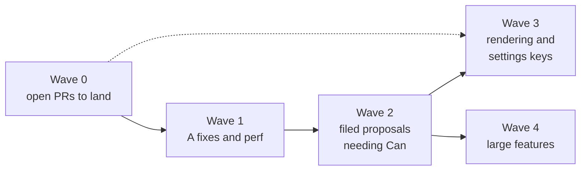

# Herdr fork: upstream audit

Audit of every change the fork carries over `herdrdev/herdr-app` (merge-base `cfcf836`, fork `master` at `c7a05ef`, 414 commits, 48,702 lines added across 244 files) and `herdrdev/herdr-core` (merge-base `3965a46`, 4 fork commits), sorted by what could go upstream as pull requests (PRs). Audited 2026-11-08 against fork `master` at `c7a05ef`; refreshed 2026-11-10 against fork `master` at `35be845`, adding the 19 features merged since (fork PRs #5 to #32, see Features added after the first audit) and the upstream PR states of that day.

## TL;DR

86 rows: the 64 `### ` sections of `FORK.md` at `c7a05ef`, 3 changes it did not list as their own section then (a shared git status and selective mod redraws, the `fix/fetch-tab` keys fix, and the already-merged Xcode build fix), and 19 features merged after it.

| Verdict | Count | Meaning |
| --- | --- | --- |
| A, upstream as is | 16 | Fixes and clear fits; 12 of them have an open upstream PR and one more rides inside #634 |
| B, upstream after reshaping | 9 | A fix or small surface can be split out; the rest moves to mods or stays |
| C, discuss with Can first | 34 | Grows the core: new commands, mod APIs, settings keys or changed defaults |
| D, fork-only | 23 | Personal taste, Rex- or bench-specific, experiments, or superseded by someone else's PR |
| Done | 4 | Merged upstream: #331 Xcode build, #662 render-test cleanup, #722 atomic writes, #729 unknown document fields |

Upstream PRs on 2026-11-10: 13 open (#332, #333, #336, #384, #411, #545, #546, #547, #634, #716, #719, #721, #752), none with a maintainer review yet; 5 merged (#331, #548, #662, #722, #729).

Best first upstream PRs (no Can gate needed, small, self-contained), and where each stands:

1. 🏁 **`fix: atomic writes keep the file's permissions`**: merged as #722.
2. ⏳ **`perf: rebuild only terminal rows that changed while output scrolls`** (`perf/changed-rows-only` + the off-screen test): open as #721; answers the rows half of the user's own issue #413.
3. ⏳ **`fix: a mod's keys.json section wins from the first start`** (`fix/fetch-tab`): open as #716.
4. **`fix: fit fallback symbols to their cells by ink`** (`fix/fallback-fit`, split out of "Terminal font fallbacks"): not opened; likely closes upstream issue #138 (fallback circled numerals overlap); no settings key.
5. **herdr-core: three fixes** (Xcode-free build, status event on adoption for the user's issue core#162, piped `attach --observe` ending at end of input): not opened; small, tested, and none grows the core.

Next: land the 13 open PRs before opening more. The `FORK.md` drift the first audit found is fixed (see Method and caveats).

## Rules applied

- **Core** (upstream `AGENTS.md`): the model, machine layout documents, commands and shared mod APIs. New core surface needs all three of: Q1 the app acts on it, Q2 only the app can see it, Q3 mods can't do it correctly even with care; then Can's go.
- **Settings keys** count as core growth for this audit: every key becomes a compatibility promise, and `cargo test` (`the_guide_explains_every_setting`) forces each one into `defaults/AGENTS.md`, the guide users' agents read.
- **Shipped layouts and mods take fixes only** (upstream `CONTRIBUTING.md`); features belong in the user's own mods. This applies to `defaults/mods/*` and, by the same logic, the shipped Settings window (`defaults/frame/settings/main.js`).
- **Platforms**: OS-specific code only where the OS differs, tested on that OS. The fork is tested on macOS only, so anything touching shared rendering, shaders or Linux and Windows backends carries platform risk.

## Dependency-ordered PR plan

### Wave 0: already open upstream, land these first

| PR | Fork feature | Verdict | Needs from Can |
| --- | --- | --- | --- |
| #333 `fix: draw variable fonts at the requested weight on macOS` | Variable font weights | A | Review. Linux equivalent is #438 (msly), worth cross-linking |
| #332 `feat: font_weight setting` | Terminal font weight | A | Review; answers issue #134 (paneq) |
| #336 `feat: letter_spacing setting` | Cell width and letter spacing (spacing half) | A | Review of the `HERDR:` gpui-pre line-layout patch; answers issue #171 |
| #384 `feat: pane.rename` | Pane names | A | Review; answers issue #322 |
| #411 `fix: never write over a broken settings.json` | Settings window keeps a broken settings.json | A | Review; it adds `scripts/settings.test.ts` and a `just test` line |
| #545 `perf: mods read one shared copy` | Mod reads share one copy | A | Review; must be merged with upstream `029323e` (mod code reused across copies, rewrites `host_modules.rs`) |
| #546 `perf: hidden terminals free their drawing caches` | Hidden terminals free their drawing caches | A | Review |
| #547 `feat: font_thicken` | Font thickening (terminal half) | A | Review of a vendor GPUI (the GPU UI framework vendored from Zed) rasteriser change; answers the user's issue #414 |
| #634 `feat: post agent alerts to the notification center` | System notifications | C | A go on three settings keys and `alert_command`; overlaps #180, #432, #120, #430, #74, #596 by others. Fold "Hung alert command test" into it |
| #716 `fix: a mod's keys.json section wins from the first start` | Mod keys win from the first start (E2) | A | Review of a vendored gpui-kit change |
| #719 `fix(mods): give frame mods a code revision` | Frame mods keep a code revision (N10) | A | Review |
| #721 `perf: rebuild only terminal rows that changed while output scrolls` | Rows kept while output scrolls (32) and the off-screen test (31) | A | Review; reply on issue #413 |
| #752 `fix: tab.move fails on a pane id instead of panicking` | `Model::move_tab` guard from Tab reordering (24) | A | Review |

Also comment on **#67** (line height, by juanibiapina) with the fork's `row_height` clamp (`de1942a`): `0` makes empty rows and a hang.

### Wave 1: A-verdict PRs to open now

Since the first audit, #1 merged (#722) and #2, #3 and #7 are open (#721, #716, #752). Still to open: #4, #5, #6 and #8.

| # | Title | Contents | Effort | Needs from Can |
| --- | --- | --- | --- | --- |
| 1 | `fix: atomic writes keep the file's permissions` | `fix/atomic-write-keeps-mode` | S | Nothing beyond review |
| 2 | `perf: rebuild only terminal rows that changed while output scrolls` | `perf/changed-rows-only`, `perf/offscreen-no-redraw` test | M | Reply on issue #413. Conflicts with upstream's three-pass `paint_grid` (already resolved once on fork `master`) |
| 3 | `fix: a mod's keys.json section wins from the first start` | `fix/fetch-tab` (`d854ce6`) | S | Review of a vendored gpui-kit change |
| 4 | `fix: fit fallback symbols to their cells by ink` | `fix/fallback-fit` (`0279c01`), without `font_fallbacks` | S | Confirm it addresses #138 |
| 5 | `perf: redraw only the mod copies that read what changed` | `9c701df` and `feb7511` from `perf/events`, without `gitStatus` | M | Review; overlaps #640 and #626 (title churn) by namastex888 |
| 6 | `bench: launch in the background and draw while covered` | `HERDR_APP_BACKGROUND`, `HERDR_BENCH_DRAW_OCCLUDED` | S | Whether a macOS vendor patch gated by an environment variable is welcome for `scripts/bench.py` (upstream owns it) |
| 7 | `fix: tab.move fails on a pane id instead of panicking` | `Model::move_tab` guard only, from `feat/tab-reorder` | S | None; reproduce the panic on `upstream/master` first (inferred from `FORK.md`, not reproduced) |
| 8 | `fix: moving the focus never resizes a framed terminal` | `frame_inset` and padding from `feat/focus-colour`, without the `focus` colour or the width setting | S | Only matters for layouts whose `focus` width differs from `border`; confirm it's wanted |

### Wave 2: proposals that need Can's go (issues already filed or to file)

| # | Proposal | Contents | Verdict | Effort | Issue |
| --- | --- | --- | --- | --- | --- |
| 9 | `window().scale_factor` for mods | `feat/mod-scale-factor` | C | S | #550 (filed). The smallest core growth in the fork, passes all three questions |
| 10 | Toasts sized to content | `feat/toast-fit-content` + `fix/toast-content-fill` | C | S | #685 (filed), branch `feat/toast-fit-content-upstream` ready |
| 11 | Spinners and text frames step present-only | `perf/spinner-repaint-only` + `perf/frames-present-only` | C | L | #413 (filed), #94, #30; competes with #383 (gusev03, Core Animation layers, macOS only) |
| 12 | Shared cached `gitStatus(folder)` | the `gitStatus` half of `perf/events` | C | M | #549 (filed) |
| 13 | Coalesced and capped agent toasts | `perf/toasts` + `fix/toast-cap-keeps-errors` | C | M | #552 (filed); the toast clock part already merged as #548 |
| 14 | Focus follows mouse | `feat/focus-follows-mouse` | C | M | #415 (filed) |
| 15 | `pane.arrange` presets and auto-arrange | `feat/pane-arrange`, `feat/auto-arrange`, `fix/bsp-split`, `feat/ls-arrange` | C | L | #551 (filed); adds a tab field to layout documents |
| 16 | Mod palette actions | `feat/mod-palette-actions` | C | M | #211 (drisspg, open); #385 closed. Asked for by others, good odds |
| 17 | `system.notify` command | the command and GPUI notification fields from `feat/native-notify` | B | M | #312 (hlidotbe, open) asks for exactly this; needs #634 first |
| 18 | Handlers inside lazy-list rows | `feat/vlist-row-handlers` | C | M | New issue needed; a mod API gap, which `CONTRIBUTING.md` invites |
| 19 | Pane text zoom | `feat/pane-zoom` | C | L | Overlaps open PR #159 `terminal.zoom_{in,out,reset}` (howardjohn); coordinate rather than compete |
| 20 | Session resume after reboot | `feat/session-resume` | C | L | #406 (jvissers), #429 (CuartPyaw: the legacy TUI did it). Strong demand |
| 21 | Pane and agent labels | `feat/agent-label` | C | M | #323 (expose terminal labels), #618; upstream `a167060` changed agent titles and conflicts |
| 22 | Focus history (`recentPlaces()`) | `feat/focus-history` | C | M | New issue needed |
| 23 | Agents without a status report | `feat/agent-fallback` | C | L | #343, #158, #98; 2.5k lines of MIT tuios manifests and a licence entry; needs a herdr-core follow-up |
| 24 | Popup terminal | `feat/popup-command` | C | L | #677 (saurabh-hirani) asks for a mod-level popup terminal |
| 25 | Floating panes, phase 1 | `feat/floating-panes`, `feat/float-header-button` | C | L | #718 (filed 2026-11-08, no reply yet); design in `fork/design/floating-panes.md` |
| 26 | Tab to another space | `feat/tab-to-space` | C | M | New issue once #718 settles, since the move carries `Tab.floating` |
| 27 | Mod terminal menu items | `feat/mod-menu-items`, `fix/menu-followups` | C | M | After #16 (mod palette actions): the same `mod.json` contract for a second list |
| 28 | Copy last output | `feat/copy-last-output` | C | S | New issue; a `terminal.copy_last_output` command reading OSC 133 marks only the app's view keeps. Offer with the pane menu copy commands (61) |
| 29 | `terminalLines()` with faint runs for mods | `feat/mod-faint-text` | B | S | New issue; the core's screen model drops styles, so only the app's grid has them |

### Wave 3: rendering and settings keys (all C; ask once, as a batch)

Each passes the three questions (only the app draws the terminal grid) but adds settings keys and, often, vendor GPUI patches. Ask Can which he wants, in one issue, before writing PRs: bold weight, faint opacity, `font_fallbacks`, `cell_width: "pixel"`, cell rounding, whole-point zoom, interface zoom and text size, interface font weight, `ui_font_thicken`, text contrast (all three shader backends), dim when inactive (adjacent to open PRs #701 and #616), theme panel derivation (changes every theme without explicit `colors`), focus colour (`focus` theme colour and `focus_border_width`), toast position (#419 by chenyn273 asks for it) and toast colours, pane spacing in Settings, pane menu copy commands, the fonts memory map (A) with the scrollback cap (C), `toast_duration` (the window's expiry clock; style, corners, marks and designs stay fork-only). Sticky "needs you" notifications (`notification_sticky`) go with #634 once it lands, not in this batch.

### Not for upstream

Build identifier, Rex theme importer, app and theme icons, subpixel smoothing, automatic pane names, tab and pane icons, icon search, working spinner, space avatar, pane header info, dock badge (superseded by #391 and #519), copied toast (superseded by #416), rejected experiments; and, added after the first audit, theme look tags, toast style, corners, marks and designs, name-matched icons, header spacing, sub-agent status, display and click, agent card info, cursor trail and cursor effects. See Rule-bending features for how the core-bending ones move into mods.

## Per-feature table

Legend: lines are **added** lines from the merge diff (`git diff M^1...M^2 --numstat`), `s` = `src/`, `v` = `vendor/`, `d` = `defaults/`, `x` = `scripts/`; `~` = summed over several merges of the same branch, so approximate. Q answers: Y yes, N no, P partly. Layers: **core** (herdr-core), **app-core** (model, commands, settings keys, shared mod APIs), **app-render** (app Rust rendering or OS), **vendor** (vendor GPUI or gpui-kit patch), **mods** (shipped `defaults/`).

| # | Feature (merge) | Lines | Layer | Q1 / Q2 / Q3 | Verdict | Effort, risk | Depends on | Upstream overlap |
| --- | --- | --- | --- | --- | --- | --- | --- | --- |
| 1 | Build identifier (`3c53f47`) | s108 d5 x9 + `build.rs`, `fork_build.rs` | app-render, build | N: label only / N / N: not wanted upstream | D | S | herdr-core build tag (`server.status.build`) | #215 (dev badge) is adjacent |
| 2 | Pane and agent labels (`35b5baf`) | s679 d35 x25 | app-core: `label`, `session` on `panes()`/`agents()`, programs.json `session_name` | N: display / P: session file by foreground pid / P: mods could repeat the rule | C | M; shipped-mod output changes | Pane names, Auto names, Session resume (`SessionFile::check`) | #323, #618; upstream `a167060` conflicts in `agents` mod |
| 3 | Rex theme importer (`4757a58`, `d5bd786`) | s524 d1 | app-core: CLI subcommand | N / N / P: needs the app's theme parser | D | S | Theme derivation, Toast look (`toast_problems`) | none; Rex is closed source |
| 4 | Focus colour (`6164aa5`) | s217 d69 x30 | app-core: `focus` colour, `focus_border_width`; shipped layout `main.json` | Y: frame inset / P / P: layouts already set widths | C (split Wave 1 #8) | M; shipped layout change replaces `main.json` | Theme derivation (`readable_accent`) | #362, #616 adjacent |
| 5 | Atomic writes keep permissions (`8eb2910`) | s36 | app-render (persist) | fix | Done | S; Unix modes, check Windows no-op | none | merged as #722 |
| 6 | Hung alert command test (`299ef1f`) | s17 | test | fix | A (inside #634) | S | System notifications (`src/alert.rs` is fork-only) | #634 |
| 7 | Pane text zoom (`0d9df8b`, `988dd24`) | ~s794 d32 x8 | app-core: 3 commands, `pane_zoom_keys`, `panes().text_size`, keys snapshot | Y / Y: per-view font / Y | C | L; macOS keys only, Linux/Windows unbound | Zoom in whole points, Cell width and rounding (`measure_cell_at`) | PR #159 (terminal.zoom commands) |
| 8 | Terminal line height (`977bef2`, `04acb83`, `de1942a`, `3234bf8`) | fork delta s17, rows ~38 | app-render | Y / Y / Y | A (review input on #67) | S | none | PR #67, issues #66, #595, PR #528 |
| 9 | Terminal font weight (`f367788`…`77c5cdc`) | branch s40 d13 | app-core: `font_weight` | Y / Y / Y | A | S | Variable font weights (to draw any weight) | PR #332, issue #134 |
| 10 | Bold terminal weight (`d54f348`) | s66 d21 | app-core: `font_weight_bold` | Y / Y / Y | C | S | Font weight | none |
| 11 | Cell width and letter spacing (`766a8de`…`85bdd70`) | branches: spacing s55 v75 d19; cell width +s60 d18 | app-core + vendor gpui-pre `line_layout.rs` | Y / Y / Y | A (#336); `cell_width` C | S/M; vendor patch checked only with a standalone copy | none | PR #336, issue #171 |
| 12 | Cell rounding (`345995d`) | s279 d11 | app-core: `cell_rounding` | Y / Y / Y | C | S; tests use CoreText (macOS) | `cell_width: "pixel"` | none |
| 13 | Settings search (`07fcfec`) | s30 d437 x246 | mods (shipped Settings window) | N / N / N: it is shipped JS | C | M; shipped UI feature, not a fix | Pages it indexes; Settings groups | none |
| 14 | Settings groups (`9dbea15`) | s89 d583 x304 | mods (Settings window), `app.settings` section ids | N / N / N | B | M; reorganisation is maintainer taste | Settings search, Handlers inside list rows (theme cards), Rex importer (chips) | #437, #591 (theme card overflow) |
| 15 | App icon and theme icon (`5fec424`, `81edac8`, `400133d`) | ~s770 d54 x427 + 1.5 MB icons | app-render (AppKit), install scripts | N / N / P | D | L; macOS only, binary size | none | none |
| 16 | Variable font weights (`fc0ab9b`, `04212f1`) | branch v93 | vendor gpui-pre-macos | fix | A | S | none | PR #333; #438 (Linux) |
| 17 | Interface font weight (`4851103`) | s46 d20 x12 v42 | app-core + vendor gpui-pre | Y / Y / Y: shaping-time offset | C | M; vendor text system | Variable font weights | none |
| 18 | Font thickening (`f4d8791`, `7de4367`, `228fdb0`, `f1460a3`, `19a3244`) | ~s269 v145 d114 x72 | app-core + vendor (rasteriser, atlas key) | Y / Y / Y | A (#547); `ui_font_thicken` C | M; macOS rasteriser only | none | PR #547, issue #414 |
| 19 | Text contrast (`037df1f`) | s50 v105 d19 x12 | app-core + vendor shaders (Metal, WGSL, HLSL) | Y / Y / Y | C | M; untested on wgpu and DirectX | Font thickening (same paint path) | #173 |
| 20 | Pane names (`d1ec36c`) | s60 d15 | app-core: `pane.rename`, layout `title` | Y / Y / Y: layout document | A | S | none | PR #384, issue #322 |
| 21 | Automatic pane names (`d67f495`) | s390 d35 x12 | app-core: `pane_auto_names`, `panes().auto_name` | N: display only / N / N: an FNV (Fowler–Noll–Vo) hash of the pane id is computable in a mod | D | M | Pane names | none |
| 22 | Tab and pane icons (`0990622`) | s712 d277 | app-core: model `icons`, layout `Document.icons`, 2 commands | N / N / P: mods can persist in a core document | D | L; layout document schema | Auto names, Space avatar | none |
| 23 | Icon search (`dcad9ec`) | s104 d12857 x310 | mods (icon-picker data) | N / N / N | D | L; 460 KB of name data, licences | Tab and pane icons, Handlers inside list rows | none |
| 24 | Tab reordering (`bd6aa5e`) | s255 d114 x226 | app-core: `tab.move_left/right`, `pane.refocus`; mods `tabs`, `menu` | P / N / P: drag is mod-side | B | M; keys snapshot files | none | #382, #192; the `move_tab` guard is PR #752 |
| 25 | Toasts fit their content (`309063b`, `39114f6`) | ~s79 d3 v19 | app-render + vendor gpui-kit | Y / Y: overlay size / Y | C | S | none | issue #685 (filed) |
| 26 | Copied toast on copy-on-select (`91011c6`, `ad9331a`) | ~s91 | app-render (`TerminalEvent::Copied`) | Y / Y: only the terminal knows / Y | D (superseded) | S | none | PR #416 (Rusya13), #344, #656, #650 |
| 27 | Toasts stand out, and go where you put them (`7c82eb4`) | s565 d84 x10 | app-core: 9 `toast*` colours, `toast_position`, `toast_offset` | P / P: top chrome / P: colours are mod-side | B | M | Theme derivation, Toasts fit | #419 (corner choice), #396, #399, #364 |
| 28 | Popup command (`1206d19`, `25de656`, `13747b0`) | ~s554 d17 | app-core: `terminal.popup`, CLI, control socket wait | Y / P / P | C | L; Unix poll semantics, `sh` portability | none | #677 |
| 29 | System notifications (`579fe72`, `ea33acc`) | ~s465 d62 | app-core: 3 keys, `alert_command`, error alert | Y / Y: background state / Y | C (PR open) | M | none | PR #634; #120, #180, #430, #432, #74, #596 |
| 30 | Notification sounds, marks, icons, `system.notify` (`e93ea37`, `bdc3a89`) | ~s1250 v158 d73 x15 | app-core + vendor GPUI platform (3 OSes) | P / P / P | B | L; images macOS only | System notifications | #312 (system.notify) |
| 31 | Off-screen terminal output (`e8690ed`) | s51 (test) | test | fix | A | S | none | #413; in PR #721 |
| 32 | Rows kept while output scrolls (`dead23a`) | s137 | app-render (`vt.rs`, `paint_grid`) | perf | A | M; conflicts with upstream find-highlight passes | none | #413 (filed); PR #721 |
| 33 | Fonts mapped, scrollback at core's cap (`f5a9881`) | s25 | app-render | perf / behaviour | B | S; truncated font file crashes | none | none |
| 34 | Hidden terminals free their drawing caches (`e226b9a`) | s218 | app-render | perf | A | S | none | PR #546 |
| 35 | Spinners turn without a draw (`ce52420`, `ef31625`) | ~s111 v258 | vendor gpui-pre scene and window, gpui-kit | Y / Y / Y | C | L; GPUI internals, all backends | none | #413, #94, #30, PR #383, closed #33 |
| 36 | Frames step without a draw (`e818502`) | s135 v242 d2 | vendor gpui-pre, gpui-kit | Y / Y / Y | C | M | Spinners turn without a draw | #94 |
| 37 | Toasts coalesced, capped and clocked (`1f1edb7`, `4756d0d`) | ~s289 v34 d4 | app-core behaviour + `mods::set_props` | Y / Y / P | C | M; changes what people see | System notifications (alert titles) | #552 (filed); clock merged as #548 |
| 38 | Mod reads share one copy (`4a984fb`) | s77 v50 d4 | vendor gpui-kit bridge + `mods.rs` | perf | A | S; merge with upstream `029323e` | none | PR #545 |
| 39 | Interface zoom and text size (`30d8cdc`, part of `abdce7d`, `ef31625`) | ~s262 v34 d33 | app-core: `ui_zoom`, `ui_text_scale`; gpui-kit style | Y / Y / Y | C | L; touches every mod's px and rem | none | #622 (traffic lights at zoom) |
| 40 | Screen scale for mods (`62ab02e`) | s30 d7 | app-core: `window().scale_factor` mod API | N / Y / Y | C | S | none | #550 (filed) |
| 41 | Background launch for tests (`66d55e9`) | s6 x1 | app-render | tooling | A | S | none | upstream `scripts/bench.py` |
| 42 | Bench draws covered windows (`105ee03`) | v36 x4 | vendor gpui-pre-macos | tooling | A (with 41, ask) | S; macOS only | Background launch | none |
| 43 | Pane arrangements (`7a85859`, `a3dcd0c`, `edb6c25`, `f8d19cc`) | ~s919 d62 x11 | app-core: `pane.arrange`, tab `arrange` in layout docs, `default_arrange` | Y / P: every split path / Y | C | L; layout document field | none | #551 (filed) |
| 44 | Focus follows mouse (`3c4212f`, `f3db1df`) | ~s812 d55 | app-core: 2 keys, `focus.toggle_follows_mouse` | Y / Y: pointer over terminals / Y | C | M | none | #415 (filed) |
| 45 | Zoom in whole points (`676f631`) | s175 d10 | app-core: `zoom_step` | Y / Y / Y | C | S | none | none |
| 46 | Settings window keeps a broken settings.json (`2261c42` part) | branch d34 x76 | mods (Settings window) | fix | A | S | none | PR #411 |
| 47 | Subpixel smoothing (`401f857`) | s85 v1058 d17 x21 | vendor gpui-pre-macos and Metal | Y / Y / Y | D (trial) | L; 1x displays only | Font thickening | none |
| 48 | Render tests clean up their folders | s16 | test | fix | Done | – | – | merged as #662 (`e7a6a91`) |
| 49 | Handlers inside list rows (`8156fed`) | s56 v470 | vendor gpui-kit shared mod API | N / N / Y: mods are refused | C | M | none | new issue needed |
| 50 | Dim when inactive (`74bc831`, `9a60387`) | ~s342 v33 d16 x8 | app-core: 3 keys + vendor GPUI veil | Y / Y / Y | C | M | none | PR #701 (veil unfocused panes), PR #616 |
| 51 | Session resume (`361af50`) | s983 d33 x7 | app-core: programs.json `resume`, `data/resume.json`, 2 commands, setting | Y / P / P | C | L; types into shells, PowerShell path | none (core's kept terminals are upstream) | #406, #429 |
| 52 | Faint opacity (`4a5ec4d` part) | ~s40 d5 | app-core: `faint_opacity` | Y / Y / Y | C | S | none | none |
| 53 | Terminal font fallbacks (`4a5ec4d` part, `c382a9b`) | ~s220 v45 d5 | app-core: `font_fallbacks` + vendor macOS | Y / Y / Y | B | M; macOS only for the setting | none | #138 (fit fix), #387, #559 |
| 54 | Agents without a status report (`ec40d46`) | s1447 d2527 + 1157 test screens | app-core (status model) + data | Y / P / P | C | L; MIT licence entry, core follow-up | none | #343, #158, #98; core #70 |
| 55 | Focus history (`40b6d42`) | s905 d51 | app-core: core document `herdr.focus`, `recentPlaces()` | N / Y: moves while mods are closed / Y | C | M | none | none |
| 56 | Pane spacing in Settings (`a94b816`) | s528 d254 x278 | app-core: `layout.spacing`, `layoutSpacing()` + Settings rows | Y / N / P | C | M | none | none |
| 57 | Theme panel derivation (`031ac3f`) | s756 d25 x11 + 574 fixture | app-render (theme resolve) | Y / Y / Y | C | M; changes every untinted theme's panels | none | #173 |
| 58 | Mod palette actions (`145643e`) | s290 d29 x79 | app-core: mod.json `actions`, `modActions()`, `mod.open` props | Y / N / Y: palette is the app's | C | M | none | #211 (open), #385 (closed) |
| 59 | Working spinner (`1a16792`) | s196 d99 x20 | app-core: `working_spinner` + shipped mods | N / N / N | D | S | Frames step without a draw | #94 (a user did it in his own mods) |
| 60 | Dock badge (`163581d`) | s320 d16 x6 | app-render (NSDockTile) + 2 keys | P / N / P | D (superseded) | M; macOS only | none | PR #391, PR #519 (`setBadge` for mods), #397 |
| 61 | Pane menu copy items (`5b9813f`, `bdc3a89` part) | ~s400 d25 | app-core: `terminal.copy/paste {terminal}`, `terminal.copy_all`, `copy_path`; menu mod | P / P: selection / P | B | M | none | #625, #178 (closed) |
| 62 | Space avatar setting (`73e2db7`) | s37 d1 | app-core: `space_avatar` (validated, passed through) | N / N / N | D | S | none | #266 |
| 63 | Pane header info (`c7a05ef`) | s827 d198 x91 | app-core: `pane_header_info`, `fitHeaderInfo()` + shipped mods | N / N / P | D | M | Shared git status (`folder_info_comes_from_the_git_status`), Labels | #112 (status in spaces sidebar) adjacent |
| 64 | Rejected text experiments | none | notes | – | D | – | – | – |
| E1 | Shared git status and selective redraws (`c01f745`, `perf/events`, **not a `FORK.md` section**) | s971 d63 | app-core: `gitStatus()`, `refreshGitStatus()`, `nextGitStatus()` + `mods.rs` revisions | Y / P / P | B | M | none | #549 (filed); #640, #626 for the title part |
| E2 | Mod keys win from the first start (`ba4f621`, `fix/fetch-tab`, filed under Focus history) | s62 v5 | vendor gpui-kit + `keys.rs` | fix | A | S | none | PR #716 |
| E3 | Build libghostty-vt without Xcode (`5d0baa0`) | 4 | build | fix | Done | – | – | merged as #331 |

## Features added after the first audit

Fork PRs #5 to #32, merged 2026-11-08 to 2026-11-10. Verdicts come from each feature's `FORK.md` section, which records its answers to the three questions; rows N4, N5 and N8, whose sections give none, were judged here. Maintenance PRs with no feature (#4 fork ADR, #8 and #28 docs, #9 review fixes, #10 flaky tests, #12 upstream sync, #13 alert dead code) have no row.

| # | Feature (fork PR) | Layer | Q1 / Q2 / Q3 | Verdict | Effort, risk | Depends on | Upstream overlap |
| --- | --- | --- | --- | --- | --- | --- | --- |
| N1 | Theme look tags (#30) | mods (Settings window) | N / N / N: it is shipped JS | D | S | Settings groups (14) | none |
| N2 | Toast time, style, corners and level mark (#11) | app-core: 4 `toast_*` keys | duration Y / Y / Y; looks N / P / N | C (`toast_duration`), D (the rest) | M | Toasts stand out (27), Toasts coalesced (37) | #419 adjacent |
| N3 | Toast designs and countdown (#15) | app-core: `toast_design`, `toast_progress` + toast mod | P / P / P | D; countdown C once N2 is offered | M; `toast_progress` adds draws while a toast counts down | N2 | none |
| N4 | Sticky "needs you" notifications (#5) | app-core: `notification_sticky` | Y: the window withdraws them / Y / Y | C, with #634 | S | System notifications (29) | PR #634 |
| N5 | Copy last output (#6) | app-core: `terminal.copy_last_output` + menu item | Y / Y: OSC 133 marks live in the app's view / Y | C | S | none | #625 adjacent |
| N6 | Name-matched icons (#7) | mods; one default value in Rust | N / N / N | D | S | Tab and pane icons (22) | none |
| N7 | Mod terminal menu items (#18, #21) | app-core: `mod.json` `menu_items`, `menuItems()` | P / Y / Y | C, after Mod palette actions (58) | M | Mod palette actions (58) | #211 |
| N8 | Header spacing (#16) | mods + `header_info` | N / N / N | D | S | Pane header info (63) | none |
| N9 | Unknown document fields kept (#17) | app-core (layout documents) | Y / Y / Y | Done | S | none | merged as #729 |
| N10 | Frame mods keep a code revision (#14) | app-core (`mods.rs`) | fix | A | S | none | PR #719 |
| N11 | Sub-agent status (#19) | app-core: `{subagents}` in `pane_header_info` + mods | P / N / P | D | M | Pane header info (63) | none |
| N12 | Sub-agent display (#24) | app-core: setting + palette runs a mod's own commands | N / N / P | D; the palette part B | M | N11 | none |
| N13 | Sub-agent click (#25) | app-core: setting | N / N / P | D | S | N12 | none |
| N14 | Agent card info (#26) | app-core: template resolved beside `pane_header_info` | Y / P / P | D | M | Pane header info (63), Shared git status (E1) | none |
| N15 | Floating panes, phase 1 (#20, #22) | app-core: `Tab.floating`, layout documents | Y / Y / Y | C | L; layout document field | N9 (so older builds keep floats) | #718 (filed) |
| N16 | Tab to another space (#23) | app-core: command + menu entry | Y / Y / P | C, after #718 | M | N15 | none |
| N17 | Mods read faint text (#27) | app-core: mod API | N / Y / Y | B | S | none | none |
| N18 | Cursor trail (#29) | app-render | Y / Y / Y | D (a visual preference) | M; draws while a trail runs | none | none |
| N19 | Cursor effects and kitty-style jump threshold (#31, #32) | app-render + `vt.rs` cursor timing | Y / Y / Y | D | M; measured within about 1% of `master` | N18 | none |

## Rule-bending features

These answer "no" to two or more of the three questions, so upstream would want them in mods. The concrete reshape for each:

| Feature | Why it bends the rule | Reshape |
| --- | --- | --- |
| Automatic pane names (21) | Display only; deterministic from the pane id, which mods see | Move the FNV word pick into the user's `pane-named` mod (it already reads `auto_name`); ship the word list in the mod folder. Nothing upstream |
| Tab and pane icons (22) | Display only; adds a model field, a layout document field and two commands | Keep choices in a mod-owned core document (as `herdr.focus` does) or `shared.json`; resolve icons in a small JS module copied into each personal mod. Upstream only needs Handlers inside list rows (49) for the picker |
| Pane and agent labels (2) | The "telling title" rule is display policy; the case for core is only "no shared code between mods" | Smaller surface: expose raw facts (`session_name` from the programs table, foreground pid) on `panes()`, which #323 asks for, and keep the precedence rule in mods. Q2 holds only for the session file read |
| Working spinner (59) | A look choice the app never acts on; a user already did it in his own mods (#94) | Drop the key; personal mods pick frames. Upstream keeps the present-only frames (36), which is what makes glyph spinners cheap |
| Space avatar (62) | The app only validates and passes the string through | Keep it in `agent-deck-spaces`' own settings or shared storage; remove `space_avatar` from `settings.rs` |
| Pane header info (63) | A template evaluated in Rust only so headers can show it | Evaluate the template in the pane header mod from `gitStatus()` (E1) and `agents()`; the only core need is E1 |
| Dock badge (60) | Count policy belongs to whoever draws the agents list | Support PR #519 (`setBadge` for mods) and compute the count in a mod; drop `dock_badge` and `dock_bounce_on_wait` |
| Notification marks and icons (30) | Agent glyphs and program icons are presentation | Upstream only `system.notify` (#312) plus GPUI `subtitle`, `sound` and `image` fields; marks and icon drawing stay in the user's `herdr-app-notify` adapter via `alert_command` |
| Toast colours (27) | Toasts are drawn by the shipped `toast` mod | Keep `toast_position` and `toast_offset` (overlay placement is the app's; #419 asks) as a C proposal; compute contrast floors in the toast mod from `theme()` as a "fix" to the shipped mod, or in a personal toast mod |
| Pane menu copy items (61) | Menu entries are shipped-mod features | Upstream the command arguments (`terminal.copy {terminal}`, `terminal.copy_all`) and the menu `target.selected` flag only; the menu entries go in a personal menu mod |
| Settings search and groups (13, 14) | Shipped Settings window features, not fixes | Offer search as a proposal (C); keep the grouping fork-only. Split the Themes grid virtualisation as a perf fix: the old Look page hit the 50 ms script budget with 125 themes |
| Tab reordering (24) | Drag UX lives in the shipped `tabs` mod | Upstream `Model::move_tab` guard (A) and possibly `tab.move_left/right` (C); the drag stays in a personal tabs mod, or is offered as a fix for "a release in a gap does nothing" |
| Focus colour (4) | A new named theme colour and a width setting | Upstream the inset fix (Wave 1 #8); a theme can already set `accent`, and layouts can set `focus` colour and width |

Legitimately core-growing (all three answers yes or near): pane text zoom, focus follows mouse, `scale_factor`, list-row handlers, focus history, mod palette actions, spinners present-only, session resume, the rendering settings. These need Can's go, not a reshape.

## herdr-core changes

| Commit | Change | Lines | Q1 / Q2 / Q3 | Verdict | Effort | Overlap |
| --- | --- | --- | --- | --- | --- | --- |
| `1af54fa` | `fix(build)`: skip Ghostty's xcframework on Apple targets (Command Line Tools without Xcode) | +6 `crates/ghostty-vt/build.rs` | fix | A | S | Same fix landed in herdr-app as #331; upstream core `build.rs` still lacks `-Demit-xcframework=false` (verified) |
| `15f9f14` | `fix(core)`: announce a status that a crash or relink adoption changed | +66 (`runtime.rs`, tests) | fix | A | S | core issue #162 (filed by the user) |
| `e105339` | `fix(core)`: end a piped `attach --observe` when its input ends (100% CPU at EOF) | +42 (`attach.rs`, `tests/m2.rs`) | fix | A | S; shared loop with Windows | Fork PR #1; core #111 is a different busy-terminal CPU bug, worth cross-linking |
| `ac1229c` | `feat(core)`: report the fork commit beside the version (`server.status.build`, `hc --version`) | +200 (schema, CLI, `fork_build.rs`) | N / N / N | D | S | Needed only by the app's Build identifier (1) |

Also pending from the app side: "Agents without a status report" (54) wants the core's `Foreground` event to carry the executable path (`crates/herdr-core/src/foreground.rs`). That is a herdr-core ask and goes through Can.

## Method and caveats

- **Verified from git**: merge-base `cfcf836` (`git merge-base master upstream/master`); all 110 first-parent merges on `master` mapped to branches; added-line counts per merge from `git diff --numstat M^1...M^2`; the 7 direct first-parent commits are small fixes and docs; upstream's 19 new commits (`git log cfcf836..upstream/master`); upstream `AGENTS.md` and `CONTRIBUTING.md` from `upstream/master`; `src/alert.rs` and `scripts/settings.test.ts` are fork-only; `scripts/bench.py` is upstream's; the icon picker's tiles use `on_click` inside `v_virtual_list` rows (so it needs feature 49).
- **Verified from GitHub** (read-only `gh issue list` and `gh pr list`, 419 issues and 292 PRs): the user's open PRs #332, #333, #336, #384, #411, #545, #546, #547, #634; merged #331, #548, #662; the user's issues #413, #414, #415, #549 to #552, #685, core #162. Issues 30, 94 and 112 are by others (spinner choppiness and spaces-sidebar status), linked where they overlap.
- **Line counts are approximate** where a branch merged into `master` several times (marked `~`): three-dot diffs can count the same lines twice or include an `upstream/master` merged into the branch. For branches cut from `upstream/master`, counts come from the branch itself (marked "branch"). Binary assets are not counted.
- **Inferred, not verified**: Q1 to Q3 answers and verdicts are judgement against upstream's rule; upstream's `tab.move` panic (row 24) was taken from `FORK.md`, not reproduced; "fit by ink closes #138" is inferred from the descriptions; settings-key growth is about 40 keys (59 new fields across `Person` and `Settings` in `src/settings.rs`) and 19 new commands (`docs/commands.md`).
- **Next upstream sync will conflict** (`git merge-tree master upstream/master`): `THIRD-PARTY-NOTICES`, `defaults/AGENTS.md`, `defaults/herdr.d.ts`, `defaults/mods/agents/main.js`, `defaults/programs.json`, `justfile`, `scripts/agents.test.ts`, `src/commands.rs`, `src/model.rs`, `src/mods.rs`, `src/window.rs`. The agents-mod and `mods.rs` conflicts touch rows 2 and 38.
- **`FORK.md` drift found, since fixed**: "Render tests clean up their folders" said awaiting review but merged as #662 (the section is gone); the toast clock in "Toasts coalesced" merged as #548 (now said); `perf/events` had no section (now "Shared git status and selective mod redraws"); `fix/fetch-tab` sat inside "Focus history" (now "Mod key sections win from the first start"); "Tab and pane icons" had no `Upstream:` line (now "none yet"). The 2026-11-10 refresh found six stale `Upstream:` lines, corrected in the same change: atomic writes (#722) and unknown document fields (#729) merged; off-screen output and rows kept (#721), mod key sections (#716) and tab reordering's `move_tab` guard (#752) open.
- **Refresh, verified 2026-11-10**: fork merges from `git log --first-parent c7a05ef..35be845`; upstream PR states from `gh pr list -R herdrdev/herdr-app --author abhijit-s --state all`; #721's files and test from `gh pr view 721`; #718 open with no comments. Line counts were not taken for rows N1 to N19.
- **Personal mods** (`~/.local/share/chezmoi/dot_config/herdr-app/mods/`), only where a fork feature exists for them: `fetch` needs `recentPlaces()` (55); `agent-deck-spaces` needs `gitStatus` (E1), `space_avatar` (62) and the icon picker (23); `agent-deck-space-menu` needs `nextGitStatus` and the icon picker; `muster` needs `scale_factor` (40); `broadcast` needs mod palette actions (58); `pane-named` reads `auto_name`, `header_info`, `session` and `working_spinner`; `reopen-tab` uses `tab.move`. Dropping a D or B feature upstream means these keep working only on the fork.
- **Platform coverage**: every feature was tested on macOS only. Highest risk for upstream: text contrast (three shader backends), spinners present-only (GPUI scene on all backends), interface zoom (every mod's sizes), notification GPUI fields (Linux and Windows paths compiled, not run).
